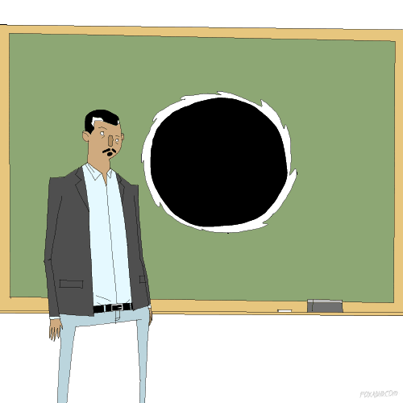

I’m Etevaldo Costa, a postdoctoral researcher at the Universidade Federal do Espírito Santo in Brazil. My interests in theoretical physics range from non-topological solitons to black holes in strong gravitational fields, from both mathematical and physical perspectives.

I have extensive experience solving elliptic partial differential equations, primarily with a finite-difference solver. I’m also familiar with shooting methods, spectral methods, and finite element methods. Beyond my work on elliptic equations, I’ve worked on eigenvalue problems such as the QMN problem. If you’re curious about how different numerical methods perform on the same physical problem, take a look at [our review of numerical methods for constructing boson stars](https://arxiv.org/abs/2609.24913).

I earned my PhD in physics at the University of Aveiro in Portugal, where I was a member of the [Gr@v group](http://gravitation.web.ua.pt/). Before that, I completed my MSc at the Universidade de São Paulo and my BSc at the Universidade Federal do Espírito Santo.

If you find anything that piques your interest, why not invite me for a coffee? I’m always open to discussing new ideas, starting collaborations, or just chatting about our common interests.

Thank you for visiting!

<!-- GIF Link to Useful Links -->

  <a href="/links/" style="text-decoration: none;">
    
    
 Useful Links →

  </a>

